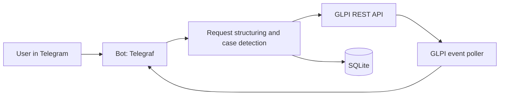

# glpi-helpdesk-bot

A Node.js Telegram bot for GLPI helpdesk workflows. Running in production under PM2 on a VPS.

Source is private; this repo documents the architecture.

## What it does

This is not a Telegram form over GLPI. Users write naturally. The bot structures the request, detects common operational cases, and creates a GLPI ticket with routing for supported request types.

- Telegram is the interface. GLPI is the source of truth for tickets, users, statuses, followups, solutions and attachments.
- Each Telegram user is linked to an active GLPI user. Works in private chats and in configured allowed groups.
- Smart splitting: when one message contains clearly separable, unrelated issues, the bot can split them into separate tickets.
- GLPI events (followups, solutions, status changes) are pushed to users in Telegram.

## Architecture

SQLite holds mappings, drafts, routing context and processed events. It does not hold ticket data.

## Key design decisions

- **GLPI is authoritative.** The bot keeps only what it needs to map Telegram identities and conversations to GLPI objects.
- **Delivery-confirmed events.** A GLPI event is marked processed only after the Telegram message was delivered. Failed deliveries are retried on the next pass.
- **Conservative over clever.** When a case is unclear, the bot prefers a normal ticket or a human decision over a guess.

## Roadmap

Planned, not implemented:

- An AI intent router that proposes structured JSON actions. The backend validates them against rules.
- Shadow mode first: run it against real traffic and compare, before it touches ticket creation.

## Stack

Node.js, Telegraf, GLPI REST API, SQLite, PM2, VPS.

<!-- TODO: screenshot (sanitized conversation) -->
